# Prompt Picker

**18+.** Prompt Picker is for adults.

Downloads are on the [releases](https://github.com/broplaygame75-ai/prompt-picker-releases/releases) page.

Auto-update uses `PromptPicker-Setup-0.1.6.exe` and `latest.yml`. Leave those file names as they are.

`PromptPicker-0.1.6-Windows.zip` contains the Setup exe, the install guide, and the pictures.

Windows may say "Windows protected your PC" because the app is not code-signed. Click **More info**, then **Run anyway**. Do not turn off SmartScreen or Defender. The pictures are illustrations.

# Install Prompt Picker 0.1.6

**18+.** This app is for adults. The pictures below are illustrations.

Windows may say "Windows protected your PC" because the app is not code-signed. Click More info, then Run anyway. Do not turn off SmartScreen or Defender.

Guides:

- [English](guide/HOW-TO-INSTALL.en.md)
- [Tiếng Việt](guide/HOW-TO-INSTALL.vi.md)
- [中文](guide/HOW-TO-INSTALL.zh.md)
- [한국어](guide/HOW-TO-INSTALL.ko.md)

Auto-update keeps using `PromptPicker-Setup-0.1.6.exe` and `latest.yml`. This zip adds the guide and the pictures beside that exe.

# How to install Prompt Picker 0.1.6

**18+.** Prompt Picker is for adults. The first launch asks "Are you 18 or older?" Yes continues and is remembered on this PC. No closes the app.

The pictures in this folder are illustrations of the steps, not screenshots of your PC.

Windows shows "Windows protected your PC" because this app is not code-signed. The warning is normal. It does not mean the file was changed. Do not turn off SmartScreen or Defender.

## 1. Download

Download `PromptPicker-Setup-0.1.6.exe`, or open `PromptPicker-0.1.6-Windows.zip` and run the Setup exe inside it. Leave `latest.yml` on the release page. The installed app uses that file to update itself.

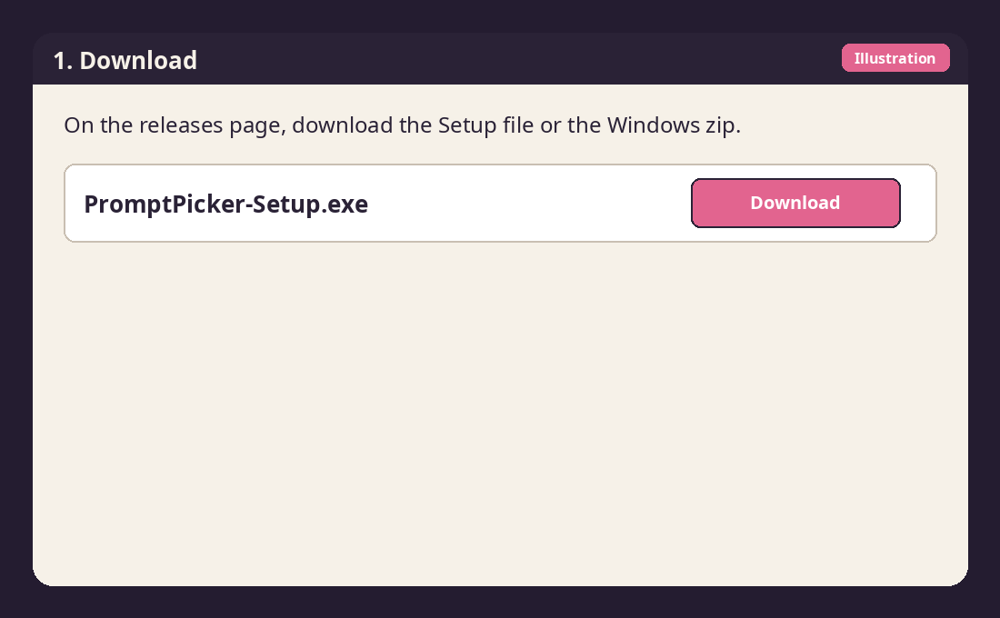

## 2. SmartScreen

Open the Setup exe. If Windows says "Windows protected your PC":

1. Click **More info**.
2. Click **Run anyway**.

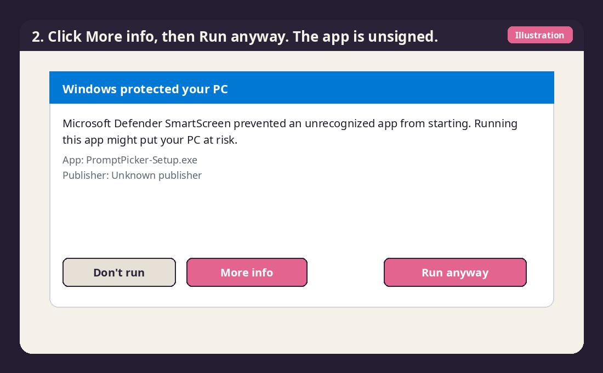

## 3. Install

Follow the installer. When Prompt Picker is already installed, the setup replaces that copy. Prompts stay in `%APPDATA%\Prompt Picker\data`.

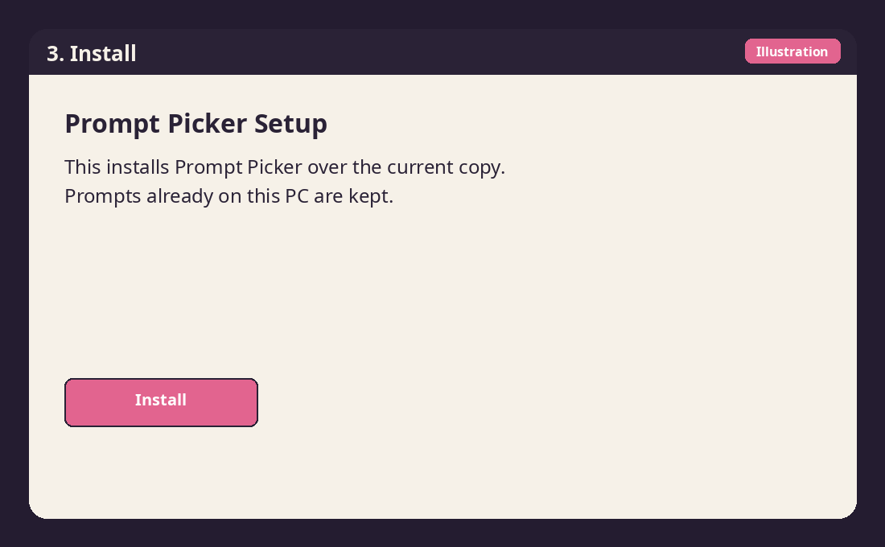

## 4. First launch

Confirm you are 18 or older, then pick a prompt.

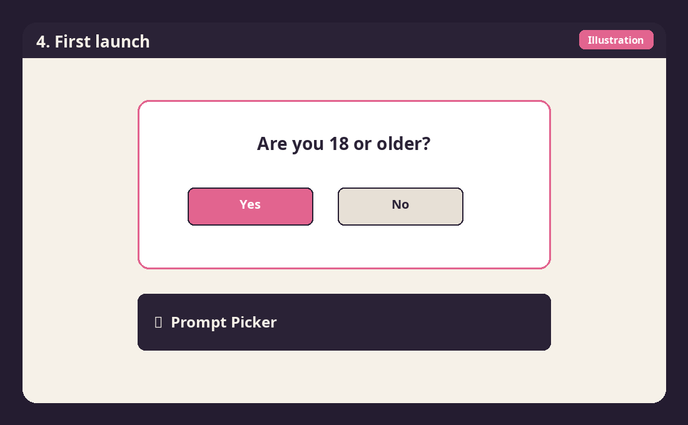

# Cách cài Prompt Picker 0.1.6

**18+.** Prompt Picker dành cho người từ 18 tuổi trở lên. Lần đầu mở, app hỏi "Bạn đã đủ 18 tuổi chưa?" Có thì vào app và được nhớ trên máy. Không thì app đóng.

Ảnh trong thư mục này là hình minh hoạ các bước, không phải ảnh chụp máy của bạn.

Windows hiện "Windows protected your PC" vì app chưa được ký số. Cảnh báo này là bình thường, không có nghĩa file đã bị sửa. Đừng tắt SmartScreen hay Defender.

## 1. Tải về

Tải `PromptPicker-Setup-0.1.6.exe`, hoặc mở `PromptPicker-0.1.6-Windows.zip` rồi chạy file Setup bên trong. Giữ nguyên `latest.yml` trên trang release. Bản đã cài dùng file đó để tự cập nhật.

## 2. SmartScreen

Mở file Setup. Nếu Windows báo "Windows protected your PC":

1. Bấm **More info** (Thông tin thêm).
2. Bấm **Run anyway** (Vẫn chạy).

## 3. Cài đặt

Làm theo bộ cài. Nếu máy đã có Prompt Picker, bộ cài ghi đè đúng bản đó. Prompt vẫn nằm ở `%APPDATA%\Prompt Picker\data`.

## 4. Mở lần đầu

Xác nhận bạn từ 18 tuổi trở lên, rồi bốc prompt.

# 如何安装 Prompt Picker 0.1.6

**18+。** Prompt Picker 仅供 18 岁及以上的人使用。第一次打开时会问“你已年满 18 岁吗？”选“是”会继续并记在这台电脑上。选“否”会关闭应用。

这个文件夹里的图片是步骤示意图，不是你电脑上的截图。

Windows 会显示“Windows 已保护你的电脑”，因为这个应用没有代码签名。这个警告是正常的，并不表示文件被改过。不要关闭 SmartScreen 或 Defender。

## 1. 下载

下载 `PromptPicker-Setup-0.1.6.exe`，或打开 `PromptPicker-0.1.6-Windows.zip` 并运行里面的安装程序。发布页上的 `latest.yml` 请保持原样。已安装的应用靠它检查更新。

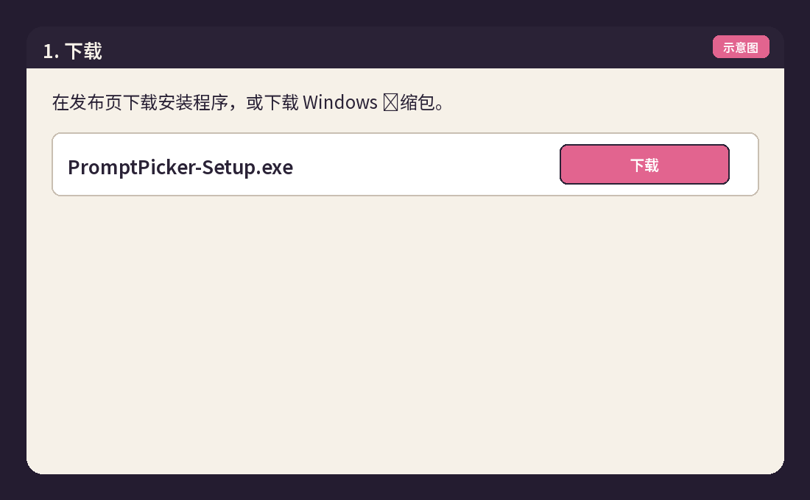

## 2. SmartScreen

打开安装程序。如果 Windows 显示“Windows 已保护你的电脑”：

1. 点击 **更多信息**（More info）。
2. 点击 **仍要运行**（Run anyway）。

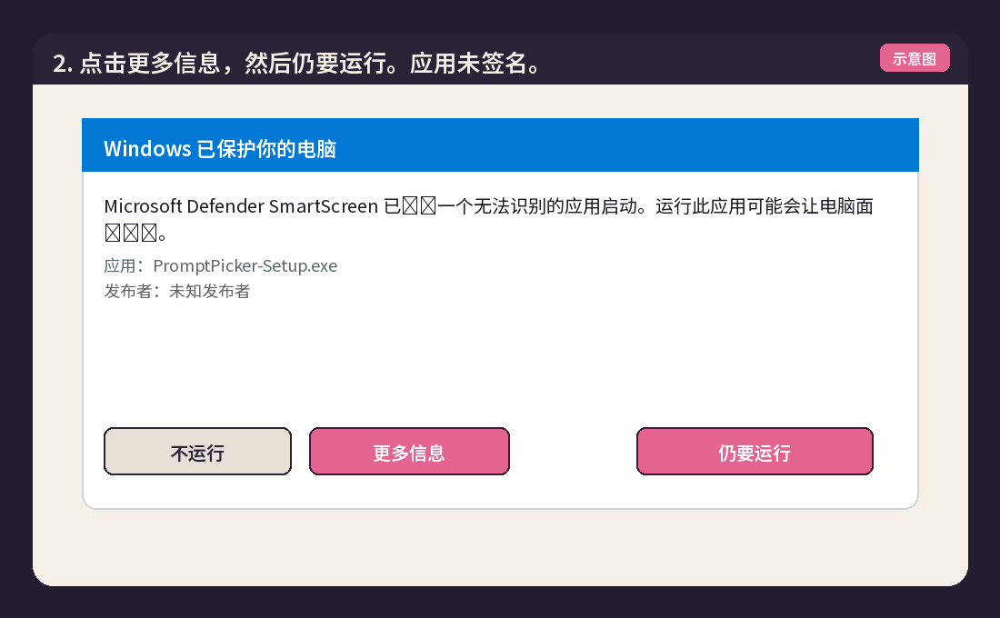

## 3. 安装

按安装程序的步骤操作。如果这台电脑已经装了 Prompt Picker，安装会覆盖那一份。提示词仍保存在 `%APPDATA%\Prompt Picker\data`。

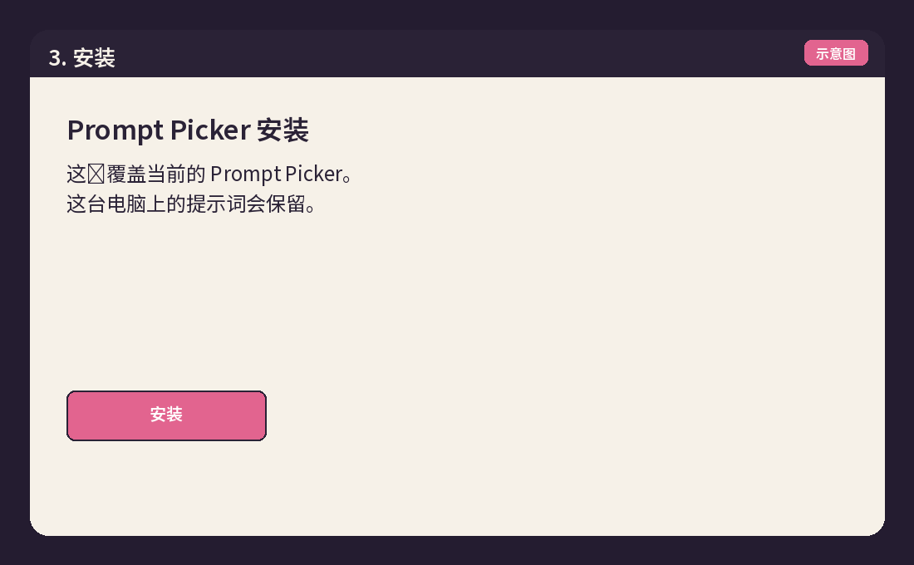

## 4. 第一次打开

确认你已年满 18 岁，然后抽取提示词。

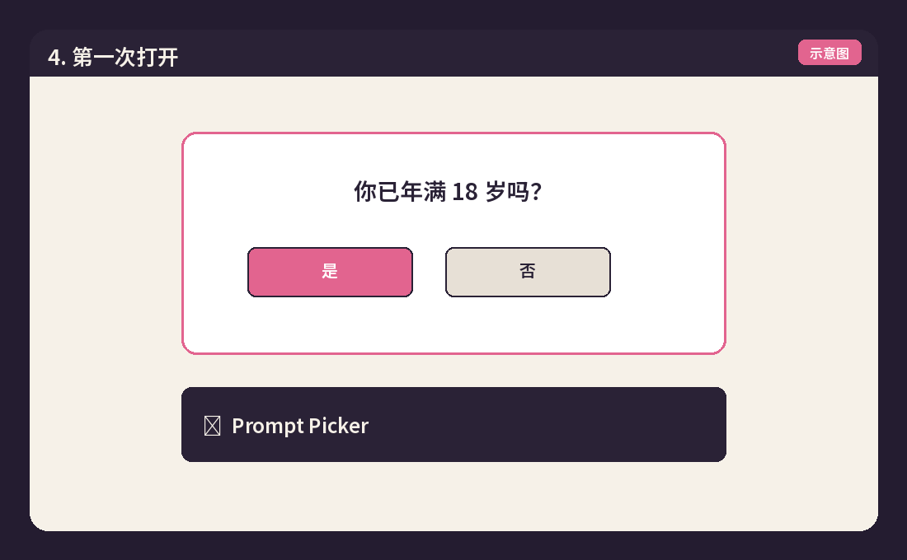

# Prompt Picker 0.1.6 설치 방법

**18+.** Prompt Picker는 18세 이상을 위한 앱입니다. 처음 실행하면 "18세 이상입니까?"라고 묻습니다. 예는 이 PC에 기억되고 앱이 열립니다. 아니오는 앱을 닫습니다.

이 폴더의 그림은 단계를 보여주는 예시이며, 내 PC의 화면 캡처가 아닙니다.

Windows가 "Windows가 PC를 보호했습니다"라고 표시하는 이유는 이 앱에 코드 서명이 없기 때문입니다. 경고는 정상입니다. 파일이 바뀌었다는 뜻이 아닙니다. SmartScreen이나 Defender를 끄지 마세요.

## 1. 다운로드

`PromptPicker-Setup-0.1.6.exe`를 받거나 `PromptPicker-0.1.6-Windows.zip`을 열고 안의 설치 파일을 실행하세요. 릴리스 페이지의 `latest.yml`은 그대로 두세요. 설치된 앱이 그 파일로 업데이트를 확인합니다.

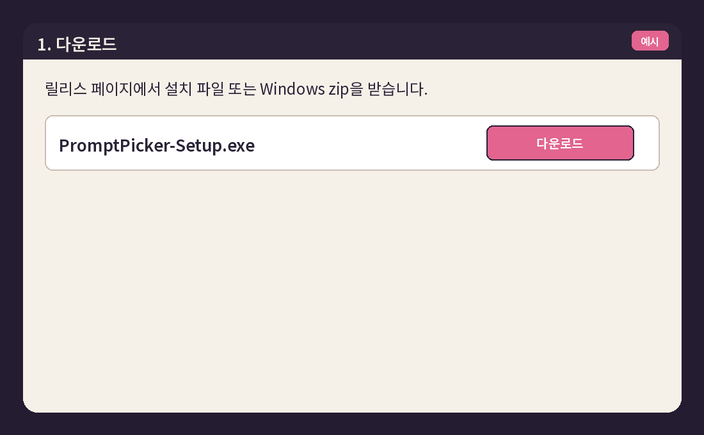

## 2. SmartScreen

설치 파일을 엽니다. Windows가 "Windows가 PC를 보호했습니다"라고 하면:

1. **추가 정보**(More info)를 클릭합니다.
2. **실행**(Run anyway)을 클릭합니다.

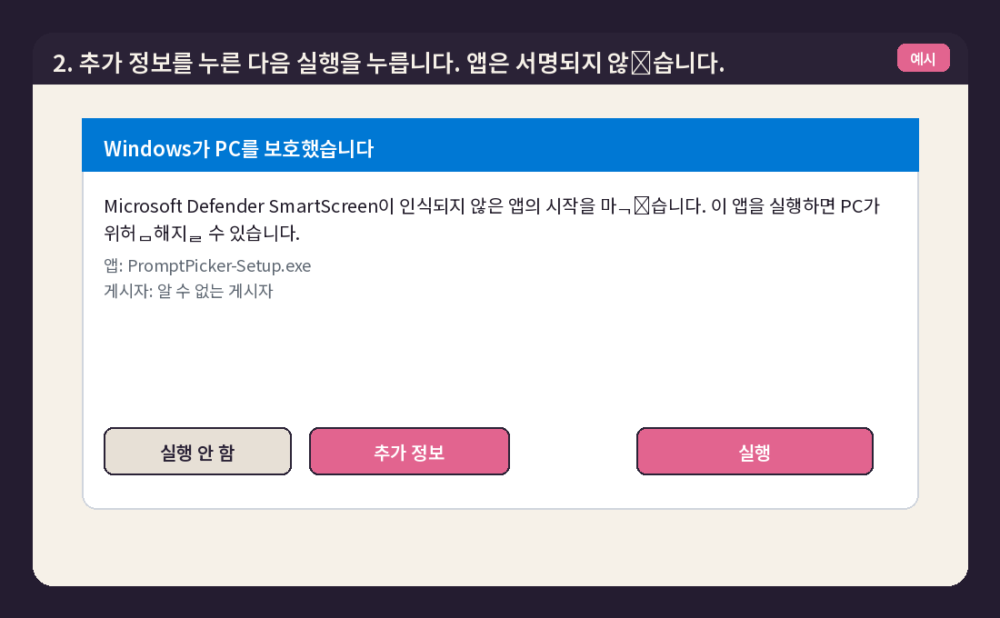

## 3. 설치

설치 프로그램의 단계를 따릅니다. 이미 Prompt Picker가 있으면 그 복사본 위에 설치합니다. 프롬프트는 `%APPDATA%\Prompt Picker\data`에 남습니다.

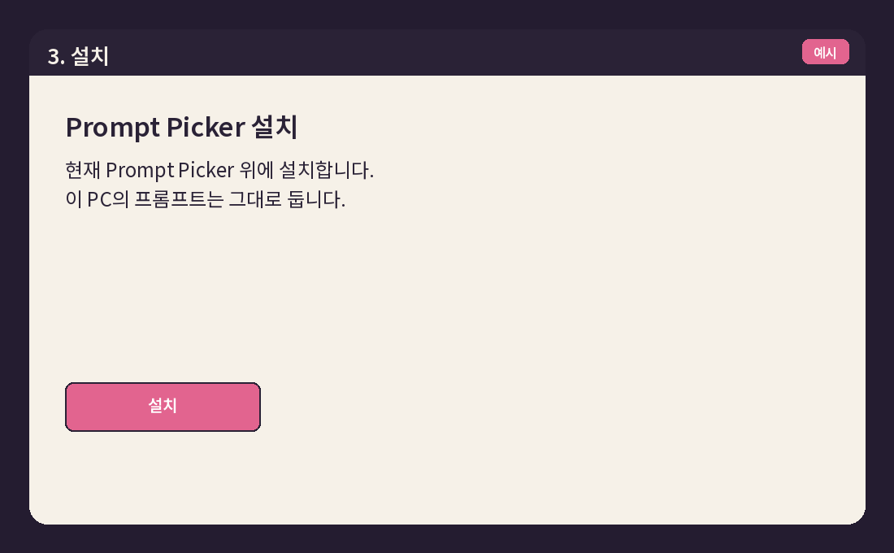

## 4. 처음 실행

18세 이상인지 확인한 다음 프롬프트를 뽑습니다.

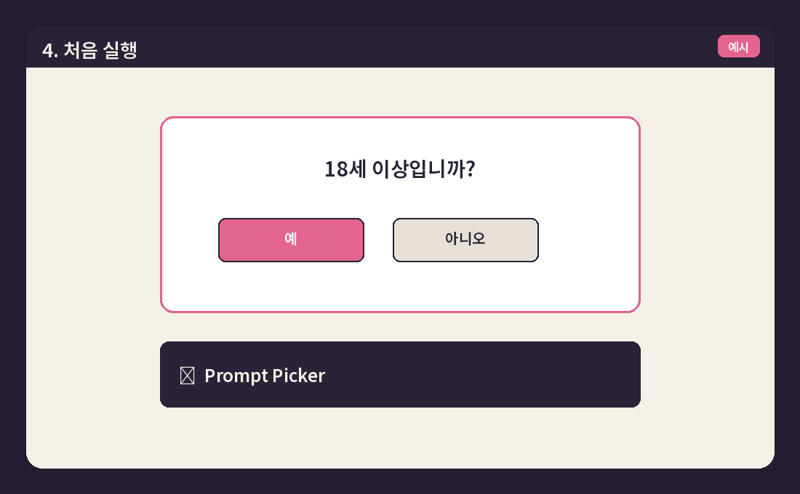
