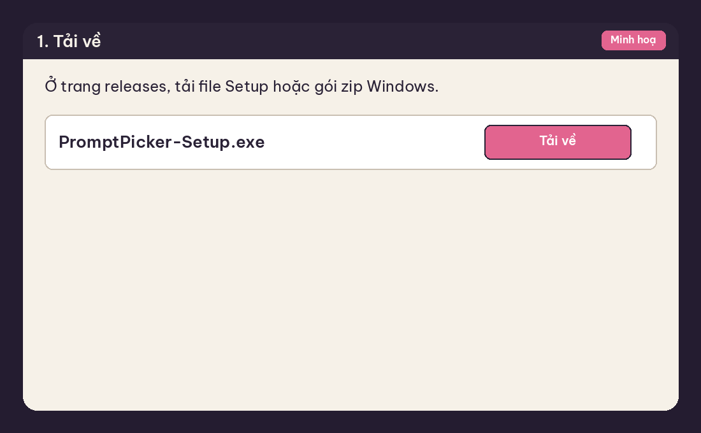
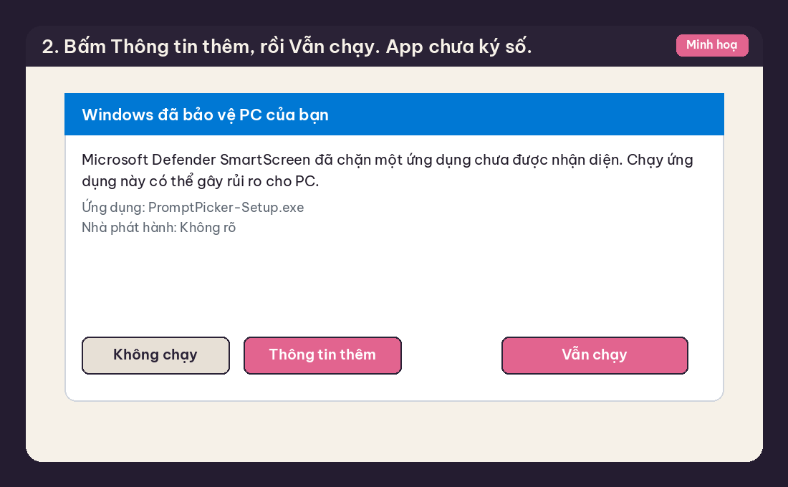
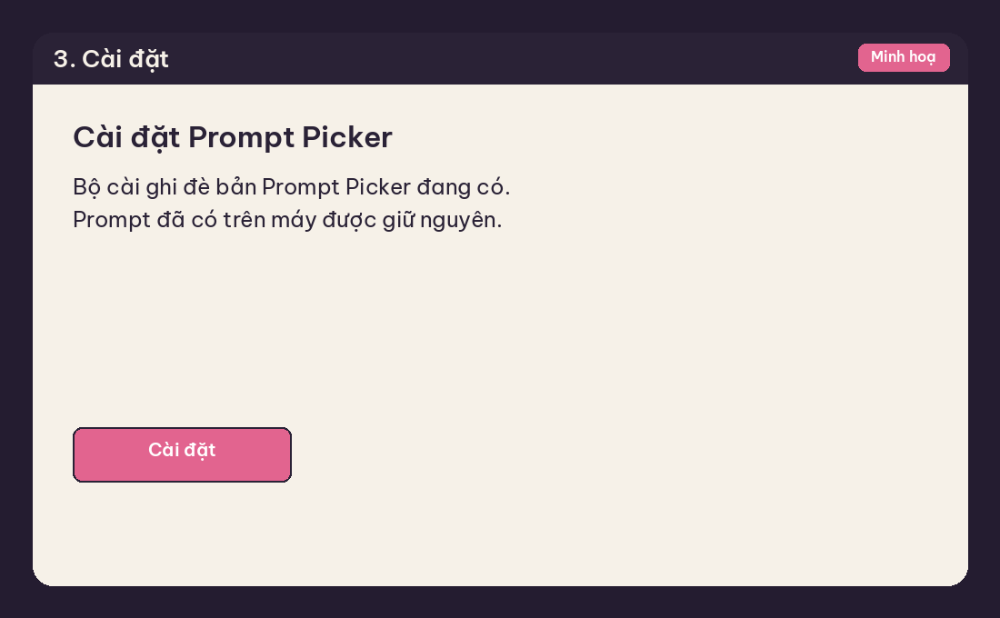
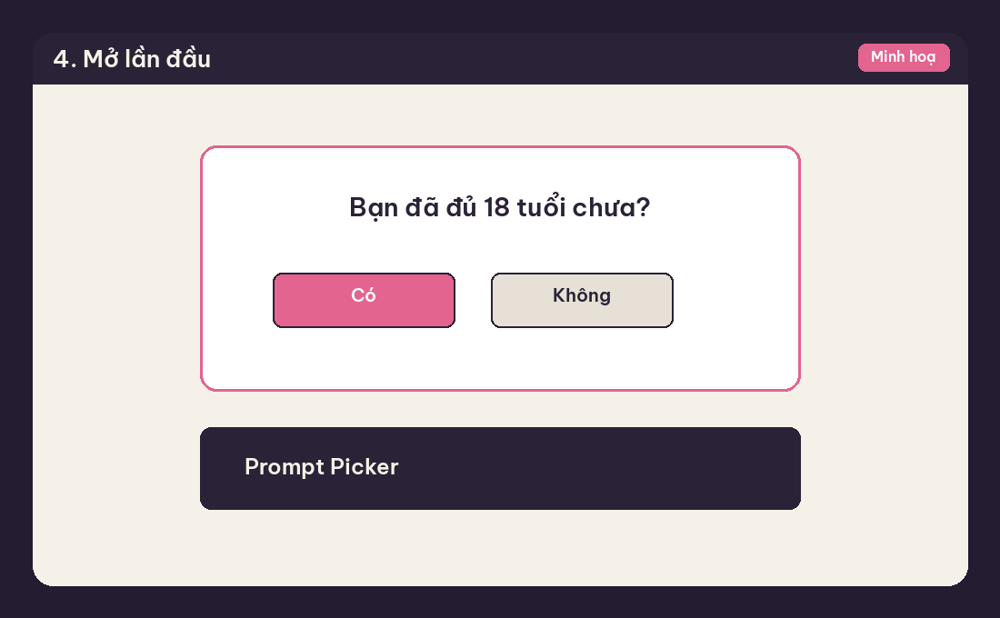

# Cách cài Prompt Picker 0.1.10

**18+.** Prompt Picker dành cho người từ 18 tuổi trở lên. Lần đầu mở, app hỏi "Bạn đã đủ 18 tuổi chưa?" Có thì vào app và được nhớ trên máy. Không thì app đóng.

Ảnh trong thư mục này là hình minh hoạ các bước, không phải ảnh chụp máy của bạn.

Windows hiện "Windows protected your PC" vì app chưa được ký số. Cảnh báo này là bình thường, không có nghĩa file đã bị sửa. Đừng tắt SmartScreen hay Defender.

## 1. Tải về

Tải `PromptPicker-Setup-0.1.10.exe`, hoặc mở `PromptPicker-0.1.10-Windows.zip` rồi chạy file Setup bên trong. Giữ nguyên `latest.yml` trên trang release. Bản đã cài dùng file đó để tự cập nhật.

## 2. SmartScreen

Mở file Setup. Nếu Windows báo "Windows protected your PC":

1. Bấm **More info** (Thông tin thêm).
2. Bấm **Run anyway** (Vẫn chạy).

## 3. Cài đặt

Làm theo bộ cài. Nếu máy đã có Prompt Picker, bộ cài ghi đè đúng bản đó. Prompt vẫn nằm ở `%APPDATA%\Prompt Picker\data`.

## 4. Mở lần đầu

Xác nhận bạn từ 18 tuổi trở lên, rồi bốc prompt.

